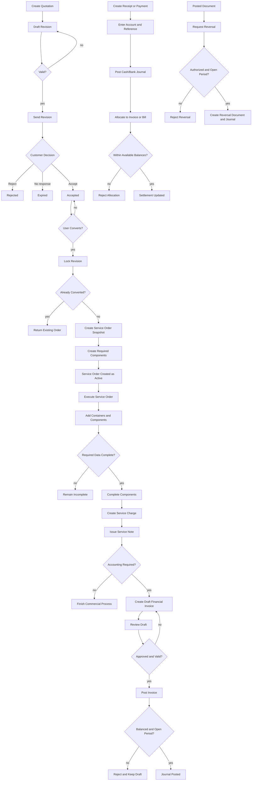

# Functional Design

## 1. Purpose

This document defines how the platform behaves internally. It translates business
requirements into module boundaries, use cases, validation rules, state
transitions, authorization decisions, transaction boundaries, error behavior, and
the frontend surfaces that expose them.

## 2. Design Principles

1. Separate operational records, commercial service charges, financial documents,
   and accounting journals.
2. The runtime is single-tenant: no organization or branch scope. Access is
   governed entirely by users, roles and permissions.
3. Use relational tables for stable references and vertical templates for dynamic
   operational data.
4. Treat sent quotation revisions and posted accounting records as immutable.
5. Prefer explicit user actions for conversion, posting, allocation, and reversal.
6. Preserve source snapshots so historical documents do not change when master
   data changes.
7. Backend modules expose routers and services; the frontend is metadata-driven
   for reference data and explicit for document workflows.

## 3. Module Boundaries

Each backend module lives at `backend/app/modules/<name>/` with `router.py`,
`service.py`, and (where it owns tables) `models.py`.

### 3.1 Identity and authorization — `auth`

Owns users, credentials, sessions, roles, permissions, role assignments, and
password-reset tokens. Provides login/refresh/logout, profile, avatar,
change-password, forgot-password, and user/role/permission administration. It does
not own business records; other modules call the permission dependency before
reading or changing records.

### 3.2 Master data — `master_data`

Owns place roles, Party Roles, trade directions, currencies and currency rates,
container types, transport types, transport assets, fee types, business parties
(+ role assignments), customer customs accounts (table only; no API/UI yet),
component tabs/groups/attributes,
configuration versions, and the generic `module_records` JSON store. It also owns
service-order tab/column configuration.

Reference records expose their `ACTIVE` / `INACTIVE` status from each list row's
action menu rather than the record form. An active record cannot be deleted — it
must be deactivated first — and the API rejects a delete of an active record with
`REFERENCE_ACTIVE`. A Party Role still referenced by a business party cannot be
deleted at all; it is deactivated instead.

### 3.3 Configuration

Configuration (component tabs, groups, attributes, versions, and their
trade-direction visibility) is owned by `master_data` and follows the same
activate-before-delete rule. It is surfaced through the Configuration pages.

### 3.4 Quotation — `quotations`

Owns quotation aggregates, immutable revisions, revision route stops/containers/lines,
and the conversion ledger.

### 3.5 Service order — `operations`

Owns service-order aggregates, route stops, container requirements, actual containers,
pricing snapshots, dynamic components and values, movements, milestones, service
charges and lines, dynamic tab rows, and attachment metadata. Service orders use a
simple `ACTIVE` / `INACTIVE` status changed from the row action menu; an active
order cannot be deleted until it is deactivated, and the API rejects deleting an
active order with `ORDER_ACTIVE`. Activity feeds and comments are not rendered for
service orders.

### 3.6 Service charge

Owned by `operations`. It calculates commercial totals and generates
customer-facing documents. It does not post accounting. A charge can later be
converted into a draft financial invoice.

### 3.7 Finance — `finance`

Owns the chart of accounts, financial accounts, accounting periods, document
sequences, posting rules, reusable financial documents, allocation, journal
entries, and reversals.

### 3.8 Document management

Owned by `operations` (attachment metadata) plus `core/storage.py` (object
storage). Handles uploads, versions, secure downloads, and pre-signed URLs.

### 3.9 Reporting — `reports`

Read-only. It must not modify operational or accounting records. The dashboard
and all report screens are served by `/reports/*`; the frontend does not compute
report figures from cached store data.

### 3.10 Settings — `settings`

Owns app info (branding) and app config (general/localization/email/telegram/
notifications/security/system/backup) in `app_settings`, mirrored into
`module_records`; global search and Ask; email/Telegram test endpoints; and
reset-data.

### 3.11 First-run setup — `auth`

Owns one-time provisioning of an empty database: permission catalog, the built-in
Platform Administrator role, administrator credential, default currency catalog,
default Party Roles and Place Roles, document sequences for the current year, and
the default app info/config records. No finance or transactional data (accounts,
periods, parties, documents) is seeded and no other user roles are created. It
runs only while no user exists, through the public `/auth/setup` page.

### 3.12 Backup — `backup`

Owns the optional Google Sheets mirror and its status, driven by an in-process
asyncio scheduler (no separate worker). Every database table is mirrored
automatically; the migration marker, the backup engine's own tables, and sensitive
columns (password/token/secret/credential) are excluded. Records are stored
locally first and retried if a Google write fails; restore can recreate missing
rows from the spreadsheet.

### 3.13 Audit — `audit`

Owns the append-only audit log. High-risk actions (financial post/reverse/
allocate, period close, journal post), permission changes, and quotation/
service-order status transitions write events; ordinary field edits are not all
audited.

## 4. Context Resolution

Every authenticated request establishes:

```text
current_user
current_permissions (from active role assignments)
request_id
correlation_id (when supplied)
```

The auth dependency:

1. Authenticates from the bearer token or HttpOnly cookie.
2. Loads the user and verifies `ACTIVE` status.
3. Resolves effective permissions from non-expired role assignments.
4. Rejects the request when the required permission is absent (`ACCESS_DENIED`).
5. Attaches the user to the request context.

## 5. Authorization Decision

A policy check receives:

```text
user_id
permission_code
resource_type
resource_id
operation
```

It returns `allowed` or `denied`. Rules:

- A granted permission applies to all records of that module (no scope).
- Expired role assignments do not grant permissions; the active assignment is the one with no expiry.
- The Platform Administrator role always resolves to every permission code.
- Record-level restrictions (for example, immutable posted records) may further
  narrow access.
- The UI may hide unavailable actions, but the API remains authoritative.

## 6. Quotation Use Cases

### 6.1 Create quotation

1. Authorize `quotation.create`.
2. Allocate a quotation number using the current-year sequence.
3. Create the quotation header and revision 1 in `DRAFT`.
4. Save children (route stops, containers, lines) in the same transaction.
5. Validate all references exist, including each pricing line's Transport Type
   from Master Data (stored by id; inactive types are hidden for new lines).

### 6.2 Send revision

1. Lock the revision.
2. Verify status is `DRAFT`.
3. Recalculate totals.
4. Validate required commercial data.
5. Set status `SENT` and `sent_at`.

### 6.3 Create revision

1. Verify the source revision is eligible.
2. Lock the quotation.
3. Allocate the next revision number.
4. Copy revision children.
5. Create the new revision as `DRAFT`.

### 6.4 Accept revision

1. Verify the revision is `SENT`.
2. Confirm the accepting actor has `quotation.accept`.
3. Mark the revision `ACCEPTED` and `accepted_at`.
4. Update the quotation aggregate status.

In the UI, **Send** and **Accept** are separate actions: a draft must be saved
before it can be sent, and only a sent revision can be accepted. Conversion is a
separate authorized action on the accepted revision (see 6.5). The document form
shows **Save changes** while there are unsaved edits and switches to the next
valid workflow action once the draft is saved.

### 6.5 Convert revision

1. Authorize `quotation.convert`.
2. Lock the accepted revision.
3. Reject if a conversion already exists with `DUPLICATE_CONVERSION`.
4. Create the service-order header and number.
5. Copy customer, direction, currency, route stops, containers, and pricing snapshots.
6. Resolve the current component configuration for the direction.
7. Create required non-repeatable component instances.
8. Create the quotation conversion record and mark the revision `CONVERTED`.
9. Commit atomically.

The conversion response keeps the quotation `id` and adds `serviceOrderId` /
`serviceOrderNo`; clients navigate using `serviceOrderId`.

## 7. Service-Order Use Cases

### 7.1 Add actual container

1. Verify the service order exists and is not inactive.
2. Verify the container requirement belongs to the same order.
3. Verify container number uniqueness.
4. Validate type, seal, and weights.
5. Create the actual container.

### 7.2 Add component

1. Authorize `service_order.update`.
2. Verify the selected template is configured for the order direction.
3. Verify repeatability rules.
4. Copy template, group, version, required flag, and sequence snapshot.
5. Create the component in `PENDING` status.

### 7.3 Save component values

1. Verify the component belongs to the service order.
2. Verify each attribute belongs to the captured template version.
3. Validate data type and reference type.
4. Reject duplicate values for non-repeatable attributes.
5. Save typed values atomically.

### 7.4 Complete component

1. Verify the component status permits completion.
2. Load captured template attributes.
3. Validate all required attributes.
4. Validate references and configured rules.
5. Set status `COMPLETED` and completion metadata.

## 8. Service-Charge Use Cases

### 8.1 Create service charge

1. Authorize `service_charge.create`.
2. Verify the service order is not inactive.
3. Create the charge in `DRAFT`.
4. Add fee lines; verify linked containers belong to the service order.
5. Calculate line and header totals.

### 8.2 Issue service charge

1. Lock the draft charge.
2. Recalculate totals and validate customer/document fields.
3. Set status `ISSUED`.
4. Render the customer-facing document from a snapshot.
5. Do not create a finance draft or a journal entry.

### 8.3 Convert charge to financial invoice

1. Authorize `service_charge.convert_to_invoice`.
2. Lock the issued service charge.
3. Copy charge lines into one draft `CUSTOMER_INVOICE`; if a draft already exists, return it.
4. Create the `SERVICE_ORDER_CHARGE` source relationship.
5. Preserve service-order and container references.
6. Allow finance users to edit the draft; do not post automatically.

## 9. Finance Use Cases

### 9.1 Create financial document

1. Authorize `financial_document.create`.
2. Validate document type and party role.
3. Allocate a document number.
4. Create the draft header and lines; calculate totals.
5. Save source references and attachments.

### 9.2 Post financial document

1. Authorize `financial_document.post`.
2. Lock the draft document; verify status is `DRAFT`.
3. Recalculate line and header totals.
4. Resolve an open accounting period (reject `PERIOD_CLOSED`).
5. Resolve posting rules and build journal lines.
6. Validate accounts are postable and that debits equal credits
   (`JOURNAL_UNBALANCED` otherwise).
7. Insert the journal entry/lines and document-posting relationship.
8. Set status `POSTED`; write the audit event; commit atomically.

### 9.3 Create manual journal

1. Authorize `journal_entry.create`.
2. Create a draft journal with lines.
3. Validate account scope and balance.
4. Permit posting only when balanced and the period is open.

### 9.4 Record payment or receipt

1. Create a financial document with the appropriate type.
2. Store payment method, financial account, reference, and value date.
3. Create draft lines and post to cash/bank and receivable/payable.
4. Allocate separately to target documents.

### 9.5 Allocate payment

1. Authorize `financial_document.allocate`.
2. Lock the payment and target documents; verify both are posted.
3. Verify type compatibility and currency (`CURRENCY_MISMATCH` otherwise).
4. Verify available payment and target balances
   (`ALLOCATION_EXCEEDS_BALANCE` otherwise).
5. Insert the allocation and audit it.

### 9.6 Reverse document

1. Authorize `financial_document.reverse`.
2. Lock the posted document; reject if already reversed
   (`DOCUMENT_ALREADY_REVERSED`).
3. Create the reversal document and opposite journal lines.
4. Post the reversal in an open period and link original/reversal records.
5. Preserve the original data.

## 10. Posting Rules

Posting rules are selected by document type and optionally fee type.

```text
CUSTOMER_INVOICE:  Dr Accounts Receivable   Cr Service Revenue   Cr Output Tax
SUPPLIER_BILL:     Dr Expense/Cost Account  Cr Accounts Payable
CUSTOMER_RECEIPT:  Dr Bank or Cash          Cr Accounts Receivable
SUPPLIER_PAYMENT:  Dr Accounts Payable      Cr Bank or Cash
```

If multiple lines use different accounts, the posting engine creates multiple
revenue/expense lines while preserving the total balance.

## 11. Error Handling

The API uses a consistent error envelope `{code, message, request_id,
field_errors}`. Stable codes include:

```text
AUTH_REQUIRED
ACCESS_DENIED
REFERENCE_NOT_FOUND
VALIDATION_ERROR
INVALID_STATE_TRANSITION
REFERENCE_ACTIVE
ORDER_ACTIVE
DUPLICATE_NUMBER
DUPLICATE_CONVERSION
DUPLICATE_USERNAME
DUPLICATE_EMAIL
DUPLICATE_ROLE
INVALID_RESET_CODE
BACKUP_RUNNING
SETUP_COMPLETED
PERIOD_CLOSED
JOURNAL_UNBALANCED
DOCUMENT_ALREADY_REVERSED
ALLOCATION_EXCEEDS_BALANCE
CURRENCY_MISMATCH
```

Errors include a request ID. Messages never reveal another record's existence
through over-specific detail.

## 12. Idempotency

The following commands use an idempotency key or an equivalent unique constraint:

- quotation conversion (`quotation_conversions.idempotency_key`);
- financial-document posting;
- journal posting;
- payment allocation (`financial_document_allocations.idempotency_key`);
- reversal;
- document-number allocation.

Repeated requests with the same key return the original result.

## 13. Concurrency and Locking

Records are locked before allocating revision numbers, converting quotations,
posting documents, allocating payments, reversing entries, and closing periods.
Number allocation uses `SELECT ... FOR UPDATE`; PostgreSQL row locks and unique
constraints are the final duplicate-prevention mechanism.

## 14. Immutability

These records cannot be edited after their final state:

- sent quotation revisions;
- converted quotation revisions;
- completed service components (except through controlled correction);
- posted financial documents;
- posted journal entries;
- closed accounting periods.

Corrections create new records linked to the original.

## 15. Reporting Rules

Reports use posted journal lines for accounting balances. Draft financial
documents are excluded from ledger balances but may appear in operational work
queues. Every report applies the permission filter and period/date filter.

## 16. Frontend Mapping

The frontend is metadata-driven for reference data and explicit for document
workflows. Each backend capability is reached through a repository. The complete
route, component, store, and validation reference is in
`docs/08_frontend_and_ui_design.md`; this table is only the functional mapping.

| Backend area | Frontend entry point |
|---|---|
| Reference collections (Party Roles, Place Roles, fee types, currencies, ...) | `/master-data/*` -> `FreightWorkspaceView` / `FreightModulePage`, `lcs-reference-modules.ts` |
| Companies / operations records | `/sales/*`, `/operations/*` -> `freight-modules.ts` metadata |
| Quotations | `/quotations[/new/:id]` -> `useQuotationCommands`, `QuotationRepository` |
| Service orders | `/service-orders[/new/:id]` -> `JobDetail`, dynamic tabs |
| Service charges | `/service-charges[/new/:id]` -> `ServiceChargeRepository` |
| Financial documents | `/finance/documents[/new/:id]` -> `useFinanceCommands`, `FinanceRepository` |
| Accounting | `/finance/{chart-of-accounts,financial-accounts,journals,accounting-periods,posting-rules}` |
| Reports | `/reports/:area/:slug` -> `FreightReportsView`, `ReportsRepository` |
| Print | `/print/:collection/:id` -> `PrintDocumentPreview` |
| Users / roles / audit | `/administration/{users,roles,audit-logs}` |
| Settings / backup | `/administration/system-settings` -> `SystemSettingsPage` |

Form rendering compiles module metadata through
`app/utils/freight/document-tabs.ts` into `AppDocumentForm`; field labels resolve
through the `freight.modules.<collection>.fields.<key>` then `freight.fields.<key>`
i18n keys. Service-order dynamic tabs are configured in the database and rendered
by `DynamicServiceOrderTabs.vue`.

## 17. Entity Relationships

The following curated ER diagram mirrors the SQLAlchemy models. The generated
`docs/06_database_design.sql` is the exhaustive table/column reference.

```mermaid
%% Entity Relationship Diagram (generated from the SQLAlchemy models)
%% Source of truth: backend/app/modules/*/models.py
%% Table count and columns: docs/06_database_design.sql (generated; currently 65 tables).
%% This diagram is a curated relationship view, not an exhaustive list; organizations
%% and branches were removed and access is user/role/permission based.
erDiagram
  %% ---------------------------------------------------------------
  %% Identity and access
  %% ---------------------------------------------------------------
  USERS ||--|| USER_CREDENTIALS : authenticates
  USERS ||--o{ USER_SESSIONS : opens
  USERS ||--o{ PASSWORD_RESET_TOKENS : requests
  USERS ||--o{ USER_ROLE_ASSIGNMENTS : receives
  USERS ||--o{ USER_ROLE_ASSIGNMENTS : assigns
  ROLES ||--o{ USER_ROLE_ASSIGNMENTS : assigned
  ROLES ||--o{ ROLE_PERMISSIONS : grants
  PERMISSIONS ||--o{ ROLE_PERMISSIONS : included

  %% ---------------------------------------------------------------
  %% Audit and backup
  %% ---------------------------------------------------------------
  USERS ||--o{ AUDIT_EVENTS : performs
  USERS ||--o{ ARCHIVE_RECORDS : archives
  USERS ||--o{ ARCHIVE_RECORDS : restores
  USERS ||--o{ ARCHIVE_RECORDS : permanently_deletes
  USERS ||--o{ BACKUP_RUNS : triggers
  BACKUP_RUNS ||--o{ BACKUP_LOGS : logs
  BACKUP_RUNS ||--o{ BACKUP_RECORDS : captures

  %% ---------------------------------------------------------------
  %% Master data and configuration
  %% ---------------------------------------------------------------
  BUSINESS_PARTIES ||--o{ CUSTOMER_CUSTOMS_ACCOUNTS : holds
  BUSINESS_PARTIES ||--o{ BUSINESS_PARTY_ROLES : holds
  PARTY_ROLES ||--o{ BUSINESS_PARTY_ROLES : assigned
  TRANSPORT_TYPES ||--o{ TRANSPORT_ASSETS : classifies
  BUSINESS_PARTIES ||--o{ TRANSPORT_ASSETS : owns
  BUSINESS_PARTIES ||--o{ TRANSPORT_ASSETS : operates
  COMPONENT_GROUPS ||--o{ COMPONENT_GROUP_ATTRIBUTES : contains
  COMPONENT_ATTRIBUTES ||--o{ COMPONENT_GROUP_ATTRIBUTES : referenced_by
  TRADE_DIRECTIONS ||--o{ COMPONENT_TABS : configures
  COMPONENT_TABS ||--o{ COMPONENT_TAB_GROUPS : composes
  COMPONENT_GROUPS ||--o{ COMPONENT_TAB_GROUPS : included_in

  %% ---------------------------------------------------------------
  %% Quotations
  %% ---------------------------------------------------------------
  BUSINESS_PARTIES ||--o{ QUOTATIONS : customer
  TRADE_DIRECTIONS ||--o{ QUOTATIONS : classifies
  USERS ||--o{ QUOTATION_REVISIONS : creates
  QUOTATIONS ||--o{ QUOTATION_REVISIONS : has
  QUOTATION_REVISIONS ||--o{ QUOTATION_REVISION_PLACES : uses
  PLACE_ROLES ||--o{ QUOTATION_REVISION_PLACES : role
  QUOTATION_REVISIONS ||--o{ QUOTATION_REVISION_CONTAINERS : requires
  CONTAINER_TYPES ||--o{ QUOTATION_REVISION_CONTAINERS : types
  QUOTATION_REVISIONS ||--o{ QUOTATION_REVISION_LINES : prices
  FEE_TYPES ||--o{ QUOTATION_REVISION_LINES : classifies
  QUOTATION_REVISION_CONTAINERS ||--o{ QUOTATION_REVISION_LINES : requirement
  USERS ||--o{ QUOTATION_CONVERSIONS : converts
  QUOTATION_REVISIONS ||--o| QUOTATION_CONVERSIONS : converts
  QUOTATION_CONVERSIONS ||--|| SERVICE_ORDERS : creates

  %% ---------------------------------------------------------------
  %% Service orders
  %% ---------------------------------------------------------------
  QUOTATION_REVISIONS ||--o{ SERVICE_ORDERS : sourced_from
  BUSINESS_PARTIES ||--o{ SERVICE_ORDERS : customer
  TRADE_DIRECTIONS ||--o{ SERVICE_ORDERS : classifies
  SERVICE_ORDERS ||--o{ SERVICE_ORDER_PLACES : uses
  PLACE_ROLES ||--o{ SERVICE_ORDER_PLACES : role
  SERVICE_ORDERS ||--o{ SERVICE_ORDER_CONTAINER_REQUIREMENTS : expects
  CONTAINER_TYPES ||--o{ SERVICE_ORDER_CONTAINER_REQUIREMENTS : types
  QUOTATION_REVISION_CONTAINERS ||--o{ SERVICE_ORDER_CONTAINER_REQUIREMENTS : source
  SERVICE_ORDER_CONTAINER_REQUIREMENTS ||--o{ SERVICE_ORDER_CONTAINERS : fulfils
  SERVICE_ORDERS ||--o{ SERVICE_ORDER_CONTAINERS : contains
  CONTAINER_TYPES ||--o{ SERVICE_ORDER_CONTAINERS : types
  SERVICE_ORDERS ||--o| SERVICE_ORDER_PRICING : has
  SERVICE_ORDER_PRICING ||--o{ SERVICE_ORDER_PRICING_LINES : contains
  FEE_TYPES ||--o{ SERVICE_ORDER_PRICING_LINES : classifies
  QUOTATION_REVISION_LINES ||--o{ SERVICE_ORDER_PRICING_LINES : source
  SERVICE_ORDERS ||--o{ SERVICE_ORDER_COMPONENT_ROWS : contains
  COMPONENT_GROUPS ||--o{ SERVICE_ORDER_COMPONENT_ROWS : groups
  SERVICE_ORDERS ||--o{ SERVICE_ORDER_MOVEMENTS : moves
  TRANSPORT_TYPES ||--o{ SERVICE_ORDER_MOVEMENTS : classifies
  TRANSPORT_ASSETS ||--o{ SERVICE_ORDER_MOVEMENTS : performs
  SERVICE_ORDERS ||--o{ SERVICE_ORDER_MILESTONES : tracks

  %% ---------------------------------------------------------------
  %% Service charges (commercial, no journal)
  %% ---------------------------------------------------------------
  SERVICE_ORDERS ||--o{ SERVICE_ORDER_CHARGES : bills
  SERVICE_ORDER_CHARGES ||--o{ SERVICE_ORDER_CHARGE_LINES : contains
  FEE_TYPES ||--o{ SERVICE_ORDER_CHARGE_LINES : classifies
  SERVICE_ORDER_CONTAINERS ||--o{ SERVICE_ORDER_CHARGE_LINES : concerns

  %% ---------------------------------------------------------------
  %% Finance and accounting
  %% ---------------------------------------------------------------
  BUSINESS_PARTIES ||--o{ FINANCIAL_DOCUMENTS : counterparty
  SERVICE_ORDERS ||--o{ FINANCIAL_DOCUMENTS : relates
  FINANCIAL_ACCOUNTS ||--o{ FINANCIAL_DOCUMENTS : settles
  FINANCIAL_DOCUMENTS ||--o{ FINANCIAL_DOCUMENTS : reverses
  FINANCIAL_DOCUMENTS ||--o{ FINANCIAL_DOCUMENT_LINES : contains
  FEE_TYPES ||--o{ FINANCIAL_DOCUMENT_LINES : classifies
  SERVICE_ORDERS ||--o{ FINANCIAL_DOCUMENT_LINES : dimensions
  SERVICE_ORDER_CONTAINERS ||--o{ FINANCIAL_DOCUMENT_LINES : concerns
  CHART_OF_ACCOUNTS ||--o{ FINANCIAL_DOCUMENT_LINES : maps
  FINANCIAL_DOCUMENTS ||--o{ FINANCIAL_DOCUMENT_SOURCES : generated_from
  FINANCIAL_DOCUMENTS ||--o{ FINANCIAL_DOCUMENT_ALLOCATIONS : pays
  FINANCIAL_DOCUMENTS ||--o{ FINANCIAL_DOCUMENT_ALLOCATIONS : settled_by
  FINANCIAL_DOCUMENTS ||--o{ FINANCIAL_DOCUMENT_POSTINGS : posts
  JOURNAL_ENTRIES ||--o{ FINANCIAL_DOCUMENT_POSTINGS : records
  CHART_OF_ACCOUNTS ||--o{ FINANCIAL_ACCOUNTS : represents
  CHART_OF_ACCOUNTS ||--o{ POSTING_RULES : debit
  CHART_OF_ACCOUNTS ||--o{ POSTING_RULES : credit
  CHART_OF_ACCOUNTS ||--o{ POSTING_RULES : tax
  FEE_TYPES ||--o{ POSTING_RULES : classifies
  ACCOUNTING_PERIODS ||--o{ JOURNAL_ENTRIES : contains
  FINANCIAL_DOCUMENTS ||--o{ JOURNAL_ENTRIES : source
  JOURNAL_ENTRIES ||--o{ JOURNAL_ENTRIES : reverses
  JOURNAL_ENTRIES ||--o{ JOURNAL_ENTRY_LINES : contains
  CHART_OF_ACCOUNTS ||--o{ JOURNAL_ENTRY_LINES : uses
  BUSINESS_PARTIES ||--o{ JOURNAL_ENTRY_LINES : dimensions
  SERVICE_ORDERS ||--o{ JOURNAL_ENTRY_LINES : dimensions
  FINANCIAL_DOCUMENTS ||--o{ JOURNAL_ENTRY_LINES : dimensions
  USERS ||--o{ ACCOUNTING_PERIODS : closes
  USERS ||--o{ ATTACHMENTS : uploads
  ATTACHMENTS ||--o{ ATTACHMENT_LINKS : links
```




## 18. Quotation, Service-Order, and Finance Process Flow




## 19. Data Flow

```mermaid
%% Data flow diagram (current implementation)
%% Single-tenant: authentication + permission check only (no organization/branch).
flowchart TD
  USER[Authenticated User] --> AUTHN[Authenticate: JWT bearer or HttpOnly cookie]
  AUTHN --> PERM[Authorize Permission]
  PERM -- denied --> DENY[403 ACCESS_DENIED / 401 AUTH_REQUIRED]
  PERM -- allowed --> API[FastAPI API /api/v1]
  API --> MOD[Module router]
  MOD --> SVC[Application service]
  SVC --> TX[(PostgreSQL - async SQLAlchemy)]
  SVC --> STORAGE[(Object Storage: local filesystem or MinIO / S3)]
  SVC --> AUDIT[Audit event - financial, security, and workflow actions]
  API --> ENV[Envelope: data / code,message,request_id,field_errors]

  subgraph Setup
    SU1[Empty database] --> SU2["/auth/setup status"]
    SU2 --> SU3[initialize: admin + PLATFORM_ADMIN + sequences + app info/config]
  end

  subgraph Quotation_to_Order
    Q1[Draft Quotation Revision] --> Q2[Send Immutable Revision]
    Q2 --> Q3[Record Acceptance]
    Q3 --> Q4[Explicit Conversion Command]
    Q4 --> Q5[Service Order Snapshot]
    Q5 --> Q6[Required Components]
  end

  subgraph Service_Charge
    S1[Service Order] --> S2[Fee Lines]
    S2 --> S3[Optional Container Links]
    S3 --> S4[Issue Customer Note]
    S4 --> S5[No Accounting Journal]
    S4 --> S6[Optional Draft Finance Invoice]
  end

  subgraph Finance_Posting
    F1[Draft Financial Document] --> F2[Validate Totals]
    F2 --> F3[Resolve Open Accounting Period]
    F3 --> F4[Resolve Posting Rules]
    F4 --> F5[Build Journal Lines]
    F5 --> F6{Debits Equal Credits?}
    F6 -- no --> F7[Reject: JOURNAL_UNBALANCED]
    F6 -- yes --> F8[Post Journal]
    F8 --> F9[General Ledger]
  end

  subgraph Settlement
    P1[Customer Receipt or Supplier Payment] --> P2[Post Cash/Bank Journal]
    P2 --> P3[Payment Allocation]
    P3 --> P4[Outstanding Balance]
  end

  subgraph Backup
    B1[In-process scheduler / manual run] --> B2[Scan all tables]
    B2 --> B3[Store rows locally: backup_records]
    B3 --> B4[Append to Google Sheets]
    B4 --> B5[On failure: retry]
  end
```


